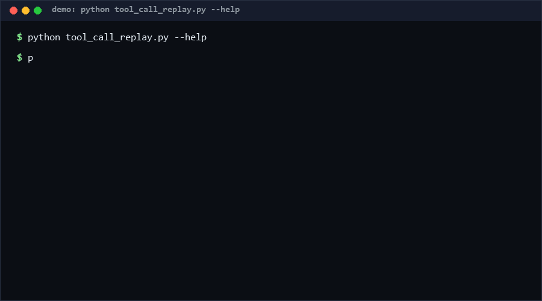

# tool-call-replay

tool-call-replay is a single-process, zero-network CLI that records an agent's tool-call sequence into a JSON snapshot and deterministically replays it later — mocking tool signatures or re-executing calls — to report per-call side-effect diffs. Use it when your agent's tool surface keeps changing and you want drift caught before a rerun, not after.

<p align="center"></p>

## Problem

Agent tool calls are the part of an LLM pipeline where silent breakage concentrates: a tool is renamed, a parameter loses a default, a refactor changes a return shape, and every downstream trace recorded against the old surface is now a lie. Re-running the full agent to find out is slow, non-deterministic, and may trigger real side effects. What is missing is a way to take one recorded call sequence and cheaply ask: *do today's tools still accept these arguments and return these results?*

## How it works

1. **Tools module** — you point the CLI at a Python file exposing a `TOOLS` dict of name → pure callable. No network, no processes: everything runs in one interpreter.
2. **Record** — a script JSON (`{"name", "args", "kwargs"}` per call) is executed in order; results, or `Type: message` errors, are written to a snapshot with no timestamps, so snapshots are byte-comparable.
3. **Replay, two modes** — `mock` never executes: it checks each recorded call still binds to the tool's signature. `verify` actually re-executes and diffs results/errors against the snapshot. Statuses: `match`, `result_diff`, `error_diff`, `unexpected_error`, `expected_error_but_ok`, `signature_error`, `missing_tool`. Exit `1` on any diff, `0` clean, `2` on input errors.

## Quickstart

Measured on a laptop, Python 3.10: total **~2 s**.

```bash
# ~0.5 s: record a call sequence against demo_tools.py
python tool_call_replay.py record --script script.json --tools demo_tools.py -o snap.json

# ~0.5 s: verify the current tools still behave identically
python tool_call_replay.py replay snap.json --tools demo_tools.py --mode verify

# ~1 s: run the self-test (58 cases)
python self_test.py
```

## Why not X

- **[auraoneai/tool-call-replay](https://github.com/auraoneai/tool-call-replay)** — normalizes agent tool-call traces into deterministic replay artifacts and pytest cases. It targets trace-format normalization and pytest integration; this repo is a standalone CLI whose snapshot/report format is plain JSON you can diff by hand.
- **[yanqr213/tool-call-replay-harness](https://github.com/yanqr213/tool-call-replay-harness)** — offline replay and assertion harness with fixtures, retries, budgets, and JUnit reports. That is CI-harness machinery; here the whole engine is one stdlib file with an explicit exit-code contract, embeddable in any runner.
- **[manuelsampedro1/agent-tool-call-replay](https://github.com/manuelsampedro1/agent-tool-call-replay)** — replays captured tool calls against current schemas to catch drift before reruns. Schema-level checking only; this repo's `verify` mode goes further and diffs actual results, catching behavioral drift that schemas cannot see.

## Minimal Fallback (PLAN B)

No Python? Pin the tool surface with `jq`:

```bash
# list every tool name + arg count in a recorded snapshot; diff this across commits
jq -r '.calls[] | "\(.name) \(.args | length) \(.kwargs | keys | join(","))"' snap.json
```

A changed line is exactly what `mock` mode's `signature_error` would have caught.

## Design Trade-offs

Priority order: **determinism > zero side-effect escape (single process) > diff precision > coverage of real agent runtimes.** Timestamps are deliberately absent from snapshots; results that cannot be JSON-serialized are stored as `repr` strings with a `result_repr` flag, which makes some diffs string-based rather than structural. Mock mode checks signatures, not semantics; only `verify` executes tools, so it is the only mode with real side effects — which is why it is not the default for unknown tools.

## Limits & Second-order Effects

- Tools must be pure or idempotent; `verify` mode re-executes them for real.
- Non-serializable results are compared by `repr`, so object-identity changes look like matches if `__repr__` is constant.
- Signatures bind, but type hints are not enforced; a `str → int` parameter change passes `mock` and only fails `verify`.
- Teams may treat green replays as proof the agent still works, masking drift in *orchestration* (which tools get called, in what order) — the report diffs the recorded sequence only.

## FAQ

**Does it support LLM/API mocking?** No — deliberately. Only local Python callables; the tool never opens sockets.

**How do I diff orchestration order?** The snapshot is a JSON array in call order; any JSON diff tool shows reordering.

**Can I replay a snapshot from a colleague?** Yes — snapshots are portable JSON plus the tools module path you trust.

**When NOT to use this tool?** (1) You need pytest-native fixtures, retries, budgets, or JUnit output — a harness like tool-call-replay-harness fits better. (2) Your traces come from a vendor format needing normalization — use a trace normalizer first. (3) Your tools have real-world side effects you cannot re-execute safely. (4) You want recorded *live* agent sessions (this records from a script you write, not from a running framework).

## [Core Assumptions]

1. Tools are pure functions or safely re-executable; the tool does not sandbox them.
2. Snapshots are frozen ground truth; tampering with them changes what "match" means (used intentionally for drift tests).
3. Determinism beats realism: no timestamps, no randomness, no network — anything nondeterministic belongs behind a tool boundary you mock.
4. The `TOOLS` dict is the contract surface; attribute-level schema drift is out of scope.

## Confidence

The record/replay/diff mechanics are fully covered by the self-test (58/58 PASS) — **High (≥80%)** they behave as documented. **Medium** that signature binding catches the drift classes users actually hit (type changes are invisible). **Low** that a single recorded sequence represents an agent's real behavior distribution.

*as of 2026-10-12*

---

Part of the [zhengming-toolbox](https://github.com/chenhz01/zhengming-toolbox) — 55 purpose-built AI-engineering tools across neglected niches.

Related tools: [model-capability-matrix](https://github.com/chenhz01/model-capability-matrix) · [model-arbitration-spec](https://github.com/chenhz01/model-arbitration-spec) · [embedding-drift-watch](https://github.com/chenhz01/embedding-drift-watch)
